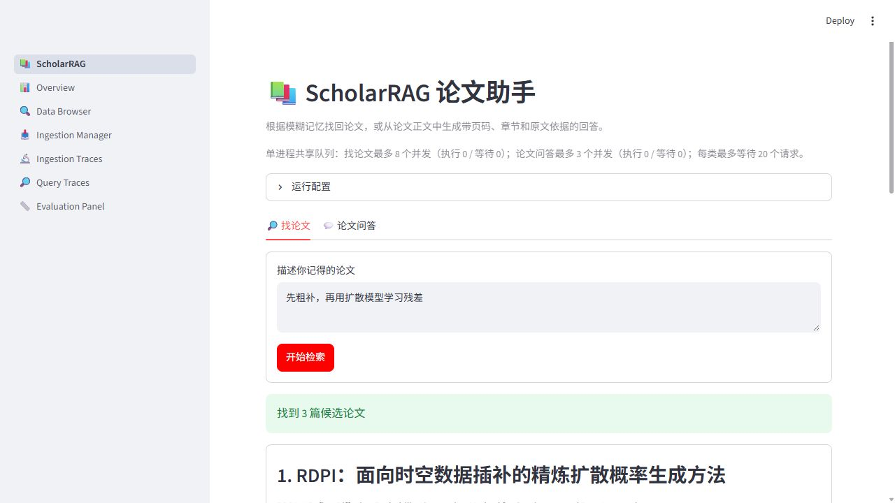
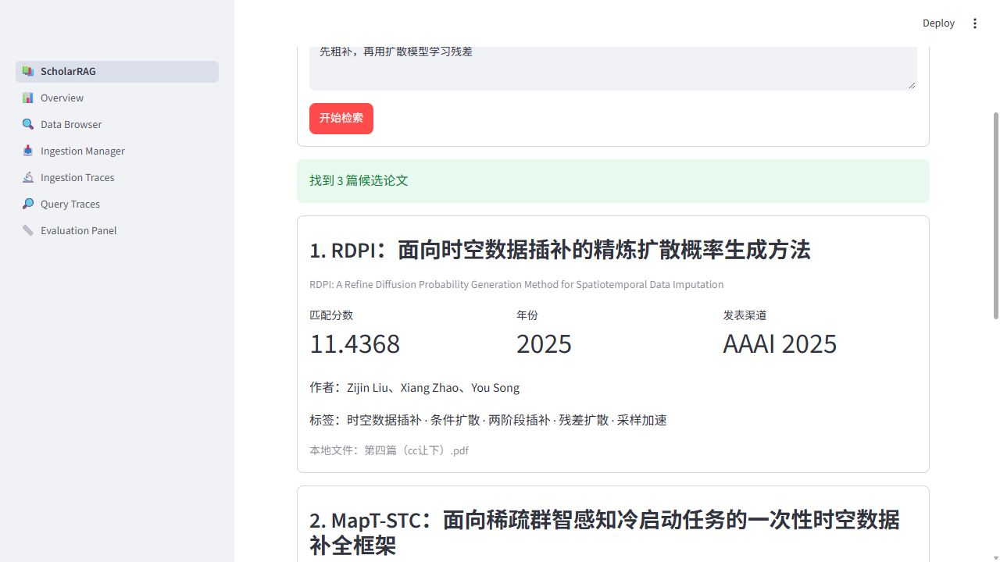
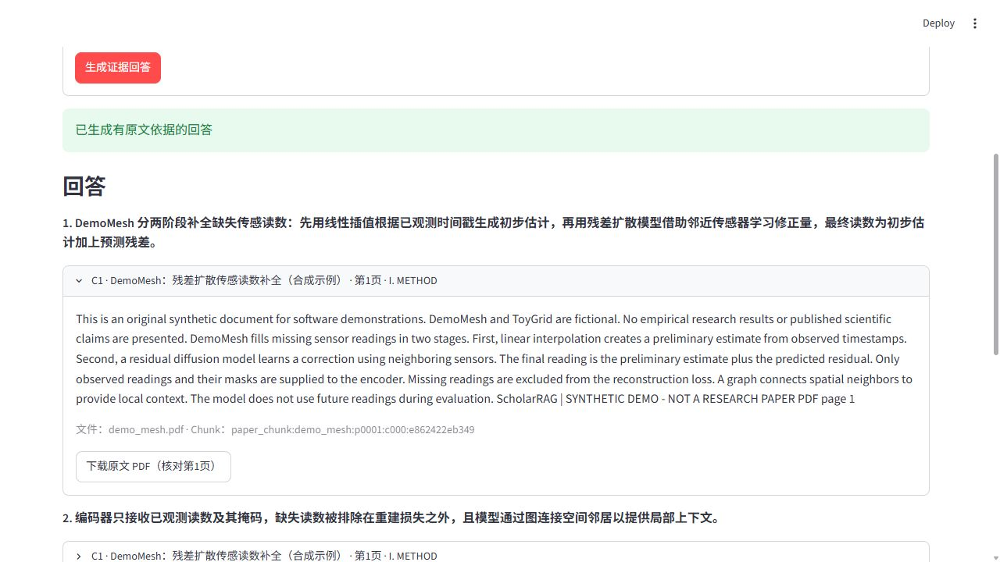
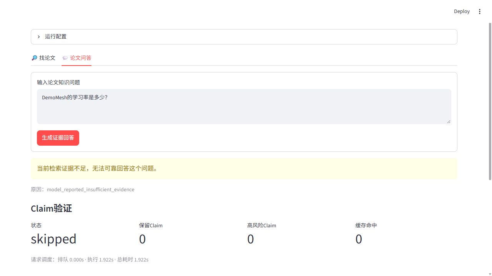
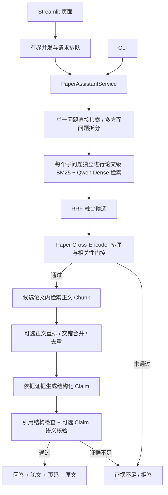

# ScholarRAG：可溯源论文检索与问答

面向已读论文与研究资料的 RAG 应用：根据模糊记忆找回论文，从正文检索证据，并生成带论文、页码和原文引用的回答。

项目围绕“找得到、答得有依据、改动能验证”构建完整流程，覆盖论文档案管理、PDF 增量入库、混合检索、多方面问题召回、结论核验和单进程请求调度。提供 Streamlit 界面、CLI，以及 `find_paper` MCP 工具。

[快速开始](#快速开始) · [检索与问答流程](#检索与问答流程) · [工程改进](#工程改进) · [评测与已知边界](#评测与已知边界) · [开发记录](#开发记录)

## 功能与界面

| 使用场景 | 系统行为 |
|---|---|
| 只记得方法或任务 | 根据标题、摘要、关键词和阅读线索检索候选论文，归并同一论文的多个文件版本 |
| 想理解一个知识点 | 先定位论文，再检索其正文 Chunk，返回回答及对应原文 |
| 一次询问多个方面 | 最多拆为三个子问题，各自选择论文和检索证据，再交错合并并去重 |
| 想核对答案出处 | 每条结论关联实际检索到的 Chunk，并展示论文、PDF 页码、章节与原文片段 |
| 库里没有对应内容 | 通过论文相关性门控、引用校验和证据不足拒答，减少强行回答 |
| 多个请求同时到达 | Web 端共享有界线程池与等待队列，队列满时提示稍后重试 |

例如，可以输入“先粗补，再用扩散模型学习残差”寻找论文，或询问“稀疏移动群智感知中的用户招募、激励机制和隐私保护分别有哪些做法”。

以下为当前 Streamlit 页面的真实截图，使用公开种子档案与 BM25 完成检索；该演示不调用外部模型，也不代表完整问答或规模库的评测结果。



<details>
<summary>查看实际返回的论文档案</summary>



</details>

### 完整问答与拒答

下面是使用[公开合成 PDF 示例包](examples/paper_demo/README.md)的真实 API 运行截图。Qwen 检索正文、生成模型依据原文回答，并开启单模型 Claim 核验。示例文档及数据集均为虚构，展示流程，不作为真实论文或质量评测。

输入“DemoMesh怎样补全缺失读数？”，展开引用可查看第 1 页原文并下载 PDF：



输入“DemoMesh的学习率是多少？”，原文未记载该参数，模型返回证据不足：



## 检索与问答流程



**论文级检索**使用 Paper Profile，包含标题、方法摘要、标签、数据集和记忆线索。BM25 处理方法名与专有词，Qwen Embedding 处理语义相似，RRF 合并两路排序；Cross-Encoder 再对“问题—论文画像”评分。它的原始 logit 用于相关性门控，不把 RRF 排名分当成概率。

**正文检索**限定在候选论文范围内。PyMuPDF 按 PDF 页解析文本，Chunk 保留 `paper_id`、`pdf_file`、`page_number`、`section` 和内容哈希。默认按 1200 字符分块、重叠 180 字符；问答默认取 7 个证据块，上下文预算为 16000 字符。这些是配置值，需随语料和题型评估。

**多方面召回**优先使用规则识别明确枚举，必要时调用模型拆分。每个子问题独立选择候选论文并检索正文，避免整句问题选出的论文限制所有方面；证据按轮次合并，避免一个方面占满 Top-K。普通单一问题不增加拆分模型调用。

**回答核验**先检查 JSON、Claim、引用编号及来源映射；开启语义核验后，再判断结论能否由所引证据推出。风险分流模式下，第一评审检查全部 Claim，第二评审只检查数字、比较、因果或复合表述等高风险项。未获支持的 Claim 可补检一次，复判仍失败则删除；没有可保留结论时拒答。

## 工程改进

| 遇到的问题 | 实现与取舍 | 代码入口 |
|---|---|---|
| 宽问题的证据集中在一个方面 | 子问题独立论文路由、独立正文召回、交错合并；保留证据安全门槛 | [service.py](src/paper_assistant/service.py)、[query_split.py](src/paper_assistant/query_split.py) |
| 找到相关论文却无法证明某条结论 | 引用结构校验、Claim–Evidence 核验、受限补检与拒答 | [grounded_answer.py](src/paper_assistant/grounded_answer.py)、[claim_safety.py](src/paper_assistant/claim_safety.py) |
| 全量双模型评审成本高 | 高风险分流与内容寻址 SQLite 缓存；证据或模型配置变化时避免复用旧判分 | [claim_judgement_cache.py](src/paper_assistant/claim_judgement_cache.py) |
| 扩库后索引构建中断或重复收费 | 按论文保存检查点、复用未变化向量；需重建时写入临时 Collection，完成后切换 | [chunk_retriever.py](src/paper_assistant/chunk_retriever.py)、[构建脚本](scripts/build_iot_chunk_index.py) |
| Chroma 大批量写入超过客户端限制 | 按客户端允许的批大小分批写入，避免一次提交全部向量 | [chroma_store.py](src/libs/vector_store/chroma_store.py) |
| 评测流程与实际问答逐渐不一致 | 评测命令复用生产 Service，避免复制一套检索与生成逻辑 | [answer_evaluation.py](src/paper_assistant/answer_evaluation.py) |
| 请求突发、外部 API 失败 | 有界队列、等待预算、限次重试、熔断及显式降级诊断 | [request_gate.py](src/paper_assistant/request_gate.py)、[resilient_llm.py](src/libs/llm/resilient_llm.py) |

运行时的主要降级路径：

- Hybrid 中 Dense/Chroma 不可用时退回 BM25，并重新应用对应门槛。
- 重排不可用时保留原始检索顺序，记录降级原因。
- 生成模型连接失败、超时或遇到 429/5xx 时限次重试；配置备用服务后可切换生成模型。
- Claim 评审不可用时，按 `strict` 拒答，或按 `evidence_only` 仅返回原文证据。

## 技术栈

| 层级 | 实现 |
|---|---|
| 业务与文档处理 | Python、PyMuPDF、CSV Paper Profile |
| 检索与索引 | 加权 BM25、jieba、Qwen `text-embedding-v4`、RRF、Chroma |
| 重排与门控 | FastEmbed / ONNX Runtime、`BAAI/bge-reranker-base` |
| 生成与验证 | 可插拔 LLM 适配、结构化 Claim、单模型 / 共识评审 |
| 界面与调用 | Streamlit、CLI、MCP |
| 持久化与诊断 | Chroma PersistentClient、SQLite 评审缓存、JSONL 请求日志 |
| 验证 | Pytest、检索评测、冻结答案回放、生产链路容量验收 |

论文业务代码集中在 [src/paper_assistant/](src/paper_assistant/)。Web 页面与 CLI 复用同一业务 Service；当前 Web 使用 Streamlit 服务端直接调用 Python，尚未接入独立 FastAPI 或 React 前端。

## 快速开始

以下 PowerShell 命令从仓库根目录执行。项目要求 Python 3.10+；首次安装依赖需要网络。

### 1. 安装

```powershell
git clone https://github.com/wujing123666/scholar-rag-paper-assistant.git
cd scholar-rag-paper-assistant
python -m venv .venv
.\.venv\Scripts\python.exe -m pip install -e ".[rerank,dev]" -c requirements-ci.txt
```

### 2. 先运行不需要 API 的论文检索

公开仓库包含一份种子论文档案。下面的命令只读取 CSV，不需要 PDF、向量库或 API Key，也不会下载重排模型：

```powershell
.\.venv\Scripts\python.exe -m src.paper_assistant --retriever bm25 --paper-reranker none search "先粗补，再用扩散模型学习残差" --top-k 3
```

JSON 返回候选论文、分数及匹配词。该模式适合验证安装和目录读取；完整语义检索与正文问答需要下面的配置和资料。

仓库另带可直接解析的合成 PDF、目录与问题，不用自行下载论文即可检查来源链路：

```powershell
.\.venv\Scripts\python.exe -m scripts.check_paper_demo
```

完整示例问答和实时 Qwen 检索评测见[公开演示说明](examples/paper_demo/README.md)。离线命令不调用模型；实时问答需要自己的 API Key。演示的目录、向量库和缓存与正式资料隔离。

安装约束固定了已测试的直接依赖版本，推荐 Python 3.12；它不是全部传递依赖的锁文件。

### 3. 配置 Qwen Embedding 与生成模型

```powershell
Copy-Item config/settings.yaml config/settings.local.yaml
```

编辑复制后的私有 YAML，替换以下两段，保留其余配置。示例使用 DeepSeek 生成与 Qwen 向量；`api_key: null` 让客户端从环境变量读取密钥：

```yaml
llm:
  provider: deepseek
  model: deepseek-chat
  api_key: null
  base_url: https://api.deepseek.com
  temperature: 0.0
  max_tokens: 4096

embedding:
  provider: qwen
  model: text-embedding-v4
  dimensions: 1024
  base_url: https://dashscope.aliyuncs.com/compatible-mode/v1
  api_key: null
```

```powershell
$env:DEEPSEEK_API_KEY = "填写自己的生成模型密钥"
$env:DASHSCOPE_API_KEY = "填写自己的Qwen密钥"
$env:SCHOLARRAG_SETTINGS = "config/settings.local.yaml"
```

`config/settings.local.yaml` 与 `config/settings.*.local.yaml` 已被 Git 忽略。建库和查询必须使用相同的 Embedding 模型、维度与服务配置；首次索引和在线语义查询会消耗 API 额度。重排模型首次使用时需要下载，之后复用本地缓存。

### 4. 准备自己的论文并建立索引

公开仓库不包含个人 PDF、扩展语料全文或预建向量库。完整问答前，需将有权使用的 PDF 放入 `data/papers/inbox/`，并让 `data/papers/paper_catalog.csv` 中每篇论文至少对应一个存在的 PDF。种子 CSV 仅供示例；没有相应 PDF 时，应先备份并替换为自己的论文目录，不能直接拿它构建完整正文索引。

新论文采用“抽取草稿 → 人工确认字段 → 预览导入 → 显式确认写入”的流程；`prepare-paper` 不会自动把候选信息写进正式目录。字段、草稿审核和增量入库命令见 [论文数据与操作说明](data/papers/README.md)。

目录与 PDF 对齐后，可显式预建正文索引：

```powershell
.\.venv\Scripts\python.exe scripts/build_iot_chunk_index.py --catalog data/papers/paper_catalog.csv --pdf-dir data/papers/inbox --embedding-settings config/settings.local.yaml --chroma-path data/db/chroma --progress-file data/papers/index/chunk_index_progress.json
```

该命令覆盖脚本的规模库默认路径，使用与默认页面一致的目录及数据库。论文画像索引在首次 Dense/Hybrid 检索时同步；正文索引也会在需要时同步，未变化的记录可复用。

### 5. 启动页面或调用 CLI

```powershell
.\.venv\Scripts\python.exe -m streamlit run src/observability/dashboard/app.py
```

浏览器打开 `http://localhost:8501`。在“运行配置”中可切换检索器、重排和 Claim 验证。未配置 API 时，选择 `bm25` 与论文相关性判定 `none`，可以先体验“找论文”。

正文问答示例：

```powershell
.\.venv\Scripts\python.exe -m src.paper_assistant --retriever hybrid --embedding-settings config/settings.local.yaml --chunk-reranker fastembed answer "这篇论文的方法解决了什么问题？" --settings config/settings.local.yaml --verify-claims single
```

| 入口 | 检索器默认值 | 论文重排 | 正文重排 | Claim 语义核验 |
|---|---|---|---|---|
| Streamlit 页面 | hybrid | fastembed | fastembed | consensus |
| 公开 PDF 演示页面 | hybrid | none | none | single |
| CLI 基础默认值 | bm25 | fastembed | none | off |

上面的 CLI 示例显式开启单模型核验。共识模式需两个不同且可调用的评审模型；CLI 可重复传入 `--claim-judge-model` 指定模型名。DeepSeek 页面共识模式会默认添加 `deepseek-v4-pro`，若账户不支持该模型，应改选 `single` 或通过 CLI 显式指定可用模型。不同入口的默认值不应混用来解释评测结果。

## 评测与已知边界

已有实验分别验证检索覆盖、回答证据、评审成本与请求调度。下表仍为历史本地实验摘要；新增公开示例的真实 API 运行另行记录，不混入这些指标：

| 验证对象 | 记录结果 | 解释范围 |
|---|---|---|
| 多方面正文检索 | 同重排配置下 Coverage@7 从 81.94% 提升到 90.28%，按原始计数增加 8.33 个百分点 | 开发集上的整句检索与方面检索对照 |
| 评审成本 | 冻结答案回放中，风险分流使评审 Token 从 82,148 降至 72,081，降低 12.25% | 固定 Claim 与证据的冷缓存回放，非线上成本承诺 |
| 规模容量 | 本地索引包含 676 篇论文、53,578 个正文 Chunk | 独立规模库配置；不是克隆仓库后自带的数据 |
| 突发问答请求 | 3 个问答 Worker 承接 20 个不同请求，全部完成；总响应 P95 约 127.58 秒 | 含排队、关闭 Claim 评审，验证承接能力，非低延迟指标 |

实验样本、对照设置、失败项、跨模型审计和结果限制见 [评测记录与口径](docs/evaluation/scholarrag-benchmarks.md)。开发题和系统构造题不能当作真实用户盲测；模型判为有证据支撑也不等于保证没有幻觉。

[公开复现指南](docs/evaluation/reproduce.md)提供脱敏逐题记录及离线计算脚本，可重新算出 Coverage、Token 降幅与门控结果；公开 PDF 支持独立重跑示例检索。前者是历史统计复算，后者是小型合成开发集，不等于重跑私有规模库实验。

当前需要关注的边界：

- 论文相关性门控偏保守，短问句及部分中英混合问法会误拒；更换重排器或语料后需要重新标定。
- 默认最多拆三个方面。复杂综述仍可能因候选范围或上下文预算而覆盖不全。
- 论文主线解析文本型 PDF；扫描件、复杂表格和公式尚缺少专门的 OCR / 结构恢复链路。页码指 PDF 页序号，不一定等于印刷页码。
- Web 队列只在一个 Streamlit 进程内共享。Chroma 适配支持 local/server，但切换数据库连接不能自动实现跨进程统一排队。
- 当前页面默认使用种子目录；规模实验通过同一 Service 的独立目录和数据库配置运行。规模库报告不代表当前页面已经部署给真实用户。
- 常规 Web 可通过 `SCHOLARRAG_CATALOG`、`SCHOLARRAG_INBOX`、`SCHOLARRAG_CHROMA_PATH`、`SCHOLARRAG_CLAIM_CACHE` 指定同一套资料与索引；切换配置时清除旧结果，避免混看不同资料库的答案。
- 全量正文稀疏结构与本地重排器占用内存较高，部署应按实际机器重新进行容量验证。

## 测试与代码导航

```powershell
.\.venv\Scripts\python.exe -m pytest tests/unit -m "not llm" -q
.\.venv\Scripts\python.exe -m src.paper_assistant --help
```

真实 API 与完整链路评测需要对应的私有配置、PDF 和索引；不能把模拟依赖的单元测试通过数当作检索准确率。

[离线 CI](.github/workflows/offline-checks.yml)在 push / PR 时运行单测、公开 PDF 检查和历史指标复算，不配置真实模型密钥。当前已在本地验证对应命令，云端结果需提交后实际运行确认。

| 目录或文件 | 职责 |
|---|---|
| [src/paper_assistant/service.py](src/paper_assistant/service.py) | 统一论文检索与问答 Service |
| [src/paper_assistant/chunk_retriever.py](src/paper_assistant/chunk_retriever.py) | 页级分块、索引同步与正文检索 |
| [src/paper_assistant/claim_safety.py](src/paper_assistant/claim_safety.py) | 结论核验、补检、过滤与失败策略 |
| [src/observability/dashboard/pages/paper_assistant.py](src/observability/dashboard/pages/paper_assistant.py) | Streamlit 交互与共享队列入口 |
| [src/mcp_server/tools/find_paper.py](src/mcp_server/tools/find_paper.py) | 论文搜索 MCP 工具 |
| [scripts/](scripts/) | 语料收集、审计、索引构建及容量验收 |
| [tests/](tests/) | 单元、集成与端到端测试 |
| [data/papers/](data/papers/) | 种子档案、开发题与数据使用说明 |

## 开发记录

`main` 保留当前可运行版本及合并历史。功能开发通过独立分支和 PR 迭代，合并后分支可删除；代表性改动包括：

- [#12 受控论文档案导入](https://github.com/wujing123666/scholar-rag-paper-assistant/pull/12)
- [#25 运行时 Claim 证据核验](https://github.com/wujing123666/scholar-rag-paper-assistant/pull/25)
- [#27 评审成本优化](https://github.com/wujing123666/scholar-rag-paper-assistant/pull/27)
- [#29 有界并发与请求排队](https://github.com/wujing123666/scholar-rag-paper-assistant/pull/29)
- [#31 多方面召回与 Qwen Embedding](https://github.com/wujing123666/scholar-rag-paper-assistant/pull/31)
- [#32 规模语料、独立方面路由与容量验证](https://github.com/wujing123666/scholar-rag-paper-assistant/pull/32)

## 来源与扩展范围

独立网页入口见 [React/FastAPI 工作台运行说明](frontend/README.md)：支持真实检索问答、同一有界 Gate 的后台任务、幂等恢复与页级 PDF 核对；当前上传写库尚未开放。

项目基于 [jerry-ai-dev/MODULAR-RAG-MCP-SERVER](https://github.com/jerry-ai-dev/MODULAR-RAG-MCP-SERVER) 的通用 RAG、MCP 与可观测性底座构建。ScholarRAG 扩展集中在论文档案与入库、论文级和正文级检索、多方面证据召回、结论核验、评测及服务可靠性。原始底座设计文档保留在 [DEV_SPEC.md](DEV_SPEC.md)。
